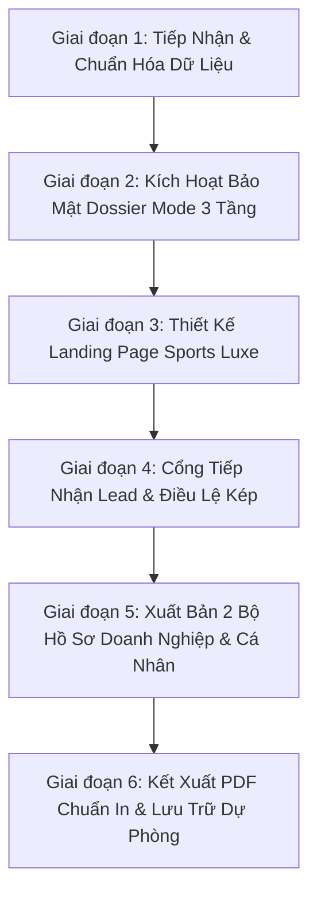

# KỸ NĂNG: QUY TRÌNH & CẨM NANG TỔ CHỨC GIẢI GOLF VÀ ĐẠI SỰ KIỆN THỂ THAO BÁO LAO ĐỘNG

### Đơn vị áp dụng: Ban Sự kiện & Chuyên đề, VPĐD Báo Lao Động tại TP.HCM & Đông Nam Bộ
> **Tuyên ngôn nghiệp vụ**: Một giải đấu thể thao hoặc đại sự kiện đối ngoại của cơ quan báo chí chính trị – xã hội muốn thành công vượt bậc phải cân bằng hoàn hảo giữa **Tầm Vóc Chính Trị & Uy Tín Báo Chí (Editorial Prestige)**, **Đẳng Cấp Thẩm Mỹ Quốc Tế (Sports Luxe Major Aesthetic)**, và **Kỷ Luật Bảo Mật Thương Mại (Confidential Dossier Mode)**.

---

## 🧭 KHUNG QUY TRÌNH CHUẨN 6 GIAI ĐOẠN (6-PHASE MASTER FRAMEWORK)



---

## 1. GIAI ĐOẠN 1: TIẾP NHẬN & CHUẨN HÓA DỮ LIỆU ĐẦU VÀO

### 1.1. Bộ ba tài liệu pháp lý & chuyên môn bắt buộc
1. **Kế hoạch tổ chức sự kiện được phê duyệt**: Thời gian tổ chức chính thức (luôn chọn Chủ Nhật để tối ưu lịch của doanh nhân), địa điểm sân thi đấu chuẩn quốc tế (PGA tiêu chuẩn).
2. **Điều lệ thi đấu chính thức (System 36)**: 11 điều khoản chi tiết (Bảng A, B, C và Bảng Nữ, cơ cấu tính Handicap ngày, giải thưởng Best Gross, Hole-in-One xe sang, giải kỹ thuật Nearest to the Pin/Longest Drive).
3. **Bảng phân bổ quyền lợi & Dự toán kinh phí nội bộ**:
   - Ma trận 6 cấp gói tài trợ Doanh nghiệp (Đặc biệt, Kim Cương, Bạch Kim, Vàng, Bạc, Đồng Hành).
   - Cơ cấu Gói Đồng Hành Cá Nhân (Mốc tiêu chuẩn 20.000.000 VNĐ).

### 1.2. Quy tắc loại trừ rủi ro (Fact-Checking & Audit)
- ❌ **Loại bỏ chữ "Nghiệp dư"**: Thay bằng cụm từ trang trọng *"Dành cho các golfer không chuyên"* hoặc *"Golfer phong trào đỉnh cao"*.
- ❌ **Kiểm toán ngày tháng**: Đảm bảo ngày thi đấu đồng bộ 100% trên toàn bộ các tệp HTML, Countdown JS, PDF, và tệp dự toán.
- 🔒 **Bảo mật tuyệt đối file tài chính**: Tuyệt đối đưa toàn bộ file `DU_TOAN*`, `*.xlsx`, `*.xls`, `*.docx` nội bộ vào `.gitignore`. Không bao giờ đẩy lên GitHub hay máy chủ công khai.

---

## 2. GIAI ĐOẠN 2: CHIẾN LƯỢC BẢO MẬT DOSSIER MODE 3 TẦNG

> **Nguyên tắc sống còn**: Không bao giờ công khai chi tiết cấu trúc quyền lợi, bảng giá hoặc file PDF tài trợ lên website đại chúng để chống đối thủ / báo khác sao chép mô hình và hạ thấp giá trị hồ sơ.

```
                  KIẾN TRÚC BẢO MẬT 3 TẦNG (CONFIDENTIAL DOSSIER)
┌─────────────────────────────────────────────────────────────────────────────┐
│ TẦNG 1: GIAO DIỆN CÔNG KHAI (LANDING PAGE INDEX.HTML)                       │
│ • Không chứa link trực tiếp tới dossier.html và dossier_ca_nhan.html        │
│ • Chỉ hiển thị nút CTA: "Đăng Ký Tài Trợ" / "Liên Hệ Ban Tài Trợ"          │
│ • Nắm quyền chủ động thu thập Lead (Tên, Doanh nghiệp, SĐT) qua form        │
└──────────────────────────────────────┬──────────────────────────────────────┘
                                       ▼
┌─────────────────────────────────────────────────────────────────────────────┐
│ TẦNG 2: BẢO VỆ CHỐNG CRAWLER & SEARCH ENGINE                                │
│ • robots.txt: Cấm Google/Bing/Cốc Cốc crawl /dossier*, /*.pdf               │
│ • Meta tag trong HTML: <meta name="robots" content="noindex, nofollow" />   │
└──────────────────────────────────────┬──────────────────────────────────────┘
                                       ▼
┌─────────────────────────────────────────────────────────────────────────────┐
│ TẦNG 3: ẤN PHẨM RIÊNG BIỆT DÀNH CHO BAN TỔ CHỨC                             │
│ • dossier.html & dossier_ca_nhan.html hoạt động độc lập (Standalone)       │
│ • Xuất PDF A4 không lỗi tràn trang để in ấn trình ký hoặc gửi Zalo 1-1      │
└─────────────────────────────────────────────────────────────────────────────┘
```

---

## 3. GIAI ĐOẠN 3: THIẾT KẾ LANDING PAGE THẨM MỸ MAJOR (SPORTS LUXE)

### 3.1. Bảng màu di sản (Championship Color Palette)
- **Augusta Masters Green (`#004d2c`, `#00331e`)**: Màu xanh di sản thể thao quý tộc, tạo cảm giác uy tín và lịch sử 97 năm Báo Lao Động.
- **Claret Jug Royal Gold (`#C5A059`, `#E5CCA0`, `#9E7D3B`)**: Nhũ vàng kim sang trọng dùng cho badge, viền thẻ VVIP và hiệu ứng gold-foil.
- **Lao Động Crimson Red (`#BE1E2D`, `#DA251D`)**: Đỏ chính luận báo Đảng/Công đoàn, dùng điểm xuyết tinh tế ở logo, thẻ chủ trì và deadline.
- **Light Editorial Background (`#FFFFFF`, `#F8FAF9`, `#CBD5E1`)**: Nền sáng ban ngày sang trọng, độ tương phản cao, chống lóa mắt.

### 3.2. Tiêu chuẩn hình ảnh thực tế (Authentic Imagery)
- **Ưu tiên ảnh Flycam thực tế góc rộng của sân đăng cai**:
  - *Ảnh hoàng hôn / Night Golf (`tsn_aerial_twilight_fairway.jpg`)*: Thể hiện quy mô 36 hố, dàn đèn chiếu sáng, hồ nước trung tâm và skyline đô thị.
  - *Ảnh góc cao green & bunkers (`tsn_aerial_green_bunkers.jpg`)*: Thể hiện độ uốn lượn, bẫy cát thử thách, có logo sân.
- **Ảnh nhân vật AI (nếu sử dụng minh họa)**:
  - 100% nhân vật là **người Châu Á / Việt Nam** độ tuổi 32–55, phong thái đĩnh đạc, tự tin, không bị lỗi giải phẫu ngón tay/gậy.
  - Trang phục thi đấu: Áo polo thể thao lịch lãm; trang phục giao lưu: Áo polo kết hợp **Blazer/Vest smart-casual** bên ly champagne sảnh Clubhouse hoàng hôn.

---

## 4. GIAI ĐOẠN 4: CỔNG TIẾP NHẬN LEAD & ĐIỀU LỆ KÉP

### 4.1. Bộ chuyển đổi Điều lệ tương tác (Rules Interactive Switcher)
- **Tab 1 - Tóm tắt nhanh**: Trực quan hóa 04 Bảng đấu (A, B, C, Nữ), thể thức System 36, cơ cấu giải Cúp Vô địch, Best Gross, Hole-in-One xe sang và Giải kỹ thuật.
- **Tab 2 - Toàn văn chính thức**: Đọc trọn vẹn 11 Điều khoản Điều lệ chuẩn pháp lý do Trưởng Ban Tổ chức ký duyệt.

### 4.2. Phân luồng tiếp nhận 2 cổng thông minh
1. **Cổng 1: Đăng Ký Golfer Thi Đấu** (`#register-golfer`): Họ tên, Số điện thoại, Email, Handicap/VGA ID, Cơ quan/CLB, Size áo thi đấu, Yêu cầu ghép flight.
2. **Cổng 2: Đăng Ký Đối Tác Doanh Nghiệp** (`#sponsor-form`): Tên Doanh nghiệp, Họ tên lãnh đạo/đại diện, Chức danh, Hotline, Không gian thương hiệu quan tâm -> Ban Thư ký đối ngoại thẩm định và gọi lại trong 2 giờ.

---

## 5. GIAI ĐOẠN 5: XUẤT BẢN 2 BỘ HỒ SƠ TÀI TRỢ RIÊNG BIỆT

### 5.1. Bộ 1: Hồ Sơ Mời Tài Trợ Doanh Nghiệp (10–12 Trang A4)
- **Trang 01**: Bìa trang trọng phong cách Major Championship.
- **Trang 02**: Thư ngỏ chính thức ký tên **BAN TỔ CHỨC**.
- **Trang 03**: Tầm vóc sự kiện & Khung lịch trình thi đấu 18 hố Shotgun.
- **Trang 04**: Đơn vị phối hợp (Sân Golf 36 hố) & Nguồn lực truyền thông Báo Lao Động.
- **Trang 05**: Sơ đồ 07 Điểm chạm thương hiệu (Tee-box, Photowall, Cúp, Gala...).
- **Trang 06**: Bảng ma trận tổng hợp quyền lợi 06 cấp tài trợ.
- **Trang 07–09**: Bóc tách chi tiết từng gói tài trợ (Chính, Kim Cương, Vàng, Bạc...).
- **Trang 10**: Quy định nhận diện thương hiệu, đăng ký và hotline Ban Tổ chức.

### 5.2. Bộ 2: Hồ Sơ Đồng Hành Cá Nhân (3 Trang A4 Quiet Luxury)
> **Đặc trưng độc bản**: Thiết kế tối giản, tinh tế, loại bỏ 100% tình trạng lặp thông tin giữa các trang.

- **Trang 1 - Bìa & Tầm vóc**: Tiêu đề giải, thời gian, địa điểm, mốc đồng hành tiêu chuẩn (20.000.000 VNĐ) và **3 Trụ Cột Tầm Vóc**: Bản lĩnh 97 năm Báo Lao Động, 144 Golfer tinh hoa đấu trường PGA, Dấu ấn danh dự khẳng định vị thế.
- **Trang 2 - Thư ngỏ trang trọng**: Lời mời Quý Golfer đồng hành với tư cách **Golfer Danh Dự**, ký tên duy nhất **BAN TỔ CHỨC**, mở rộng trực quan ảnh flycam sân 36 hố và Clubhouse 10.000m².
- **Trang 3 - Đặc quyền & Bảng vàng thực thi (DUY NHẤT)**:
  1. *Quyền lợi cốt lõi*: 01 Suất FOC thi đấu trọn gói + Vinh danh họ tên trên Bảng Vàng sảnh Clubhouse.
  2. *Quy chuẩn in đậm bắt buộc*: **Kích thước size chữ họ tên tỉ lệ thuận với giá trị tài trợ (mốc 20 triệu VNĐ). Mức tài trợ càng cao, kích thước họ tên hiển thị càng lớn tương ứng.**
  3. *Mô phỏng 3D Bảng Vàng (3 cấp bậc size chữ: 50Tr - 30Tr - 20Tr)*.
  4. *Lịch trình thi đấu 4 mốc (Check-in, Khai mạc, Shotgun, Gala Dinner)*.
  5. *Đầu mối tiếp nhận độc quyền 24/7*: Mrs. Thanh Thuỳ – 0908221195.

---

## 6. GIAI ĐOẠN 6: KẾT XUẤT PDF CHUẨN IN & LƯU TRỮ DỰ PHÒNG

### 6.1. Quy chuẩn Print CSS A4 Portrait (Tuyệt đối không tràn trang)
```css
@page {
  size: A4 portrait;
  margin: 0;
}
.page-sheet {
  width: 210mm;
  height: 297mm;
  min-height: 297mm;
  max-height: 297mm;
  overflow: hidden;
  box-sizing: border-box;
  page-break-after: always;
}
```

### 6.2. Lệnh Render PDF không Header/Footer qua Headless Chrome
```bash
/Applications/Google\ Chrome.app/Contents/MacOS/Google\ Chrome \
  --headless=new \
  --disable-gpu \
  --disable-background-networking \
  --no-pdf-header-footer \
  --print-to-pdf="HSTT_Ca_Nhan_Golf_Bao_Lao_Dong_2026.pdf" \
  --user-data-dir="/tmp/chrome_print_tmp" \
  "file://$(pwd)/dossier_ca_nhan.html"
```

### 6.3. Quy trình Đóng gói Bản sao lưu dự phòng (Disaster Recovery)
Khi hoàn tất phiên bản chuẩn được nghiệm thu:
1. Tạo thư mục `_backups/YYYY-MM-DD_ten_phien_ban_chuan/`.
2. Sao chép toàn bộ HTMLs, PDFs, ảnh gốc thực tế và nhật ký làm việc vào thư mục đó.
3. Đóng gói thành tệp nén `.zip` độc lập (ví dụ: `BAN_SAO_DU_PHONG_GOLF_LAO_DONG_2026_10_23.zip`).
4. Commit và push cả thư mục backup lên Git để bảo vệ dữ liệu 2 lớp (Local + Cloud).

---

## 7. GIAI ĐOẠN 7: TỰ ĐỘNG HÓA TÁI TẠO DỰ ÁN MỚI (ONE-COMMAND SCAFFOLDING)

Hệ thống trang bị cỗ máy sinh dự án tự động độc lập `scripts/scaffold_event.py` và bộ template `_templates_sports_luxe/sample_event_config.json`. Bất kỳ khi nào cần tạo sự kiện thể thao/golf mới tương tự, thực hiện theo 2 bước:

### 7.1. Chạy bằng CLI
```bash
# 1. Khởi tạo file cấu hình sự kiện mới
python3 scripts/scaffold_event.py --init config_giai_moi.json

# 2. Sinh trọn bộ sản phẩm (Landing Page, 2 Dossier, robots.txt, vercel.json, render script)
python3 scripts/scaffold_event.py --build --config config_giai_moi.json --out ./Giai_Dau_Moi

# 3. Xuất PDF tự động
cd ./Giai_Dau_Moi && python3 render_pdf.py
```

### 7.2. Tương tác với AI qua một câu lệnh
Khi người dùng yêu cầu: *"Tạo bộ hồ sơ và landing page cho giải [Tên giải]..."*, Agent phải:
1. Đọc thông số đầu vào từ yêu cầu (hoặc hỏi bổ sung nếu thiếu ngày/địa điểm).
2. Tạo file cấu hình `event_config.json` theo chuẩn `sample_event_config.json`.
3. Chạy `scaffold_event.py --build` để sinh toàn bộ mã nguồn.
4. Tự động chạy `render_pdf.py` qua Headless Chrome để xuất bản sẵn 2 tệp PDF.
5. Bàn giao đầy đủ đường link và bản sao lưu cho người dùng.

---

## 📋 CHECKLIST KIỂM TOÁN CHẤT LƯỢNG (BẮT BUỘC TRƯỚC KHI BÀN GIAO)

- [ ] Toàn bộ ngày tháng sự kiện đã được đồng bộ chuẩn xác (Ví dụ: Chủ Nhật 15.11.2026).
- [ ] Hotline Ban Tổ chức hiển thị rõ 2 đầu mối: Chuyên môn Golfer và Đối ngoại Doanh nghiệp.
- [ ] Đã gỡ bỏ 100% link dẫn trực tiếp tới 2 file dossier trên trang chủ (kích hoạt Dossier Mode).
- [ ] Đã kiểm tra `robots.txt` cấm bot thu thập dữ liệu hồ sơ và file PDF.
- [ ] Cả 2 file dossier đều có thẻ `<meta name="robots" content="noindex, nofollow" />`.
- [ ] Đã xuất in PDF kiểm tra số trang: Hồ sơ Cá nhân đúng 3 trang, Hồ sơ Doanh nghiệp đúng 10 trang.
- [ ] File Excel dự toán nội bộ nằm trong `.gitignore`, không bao giờ push lên Git/Vercel.
- [ ] Đã tạo tệp zip sao lưu dự phòng trong thư mục `_backups/`.

